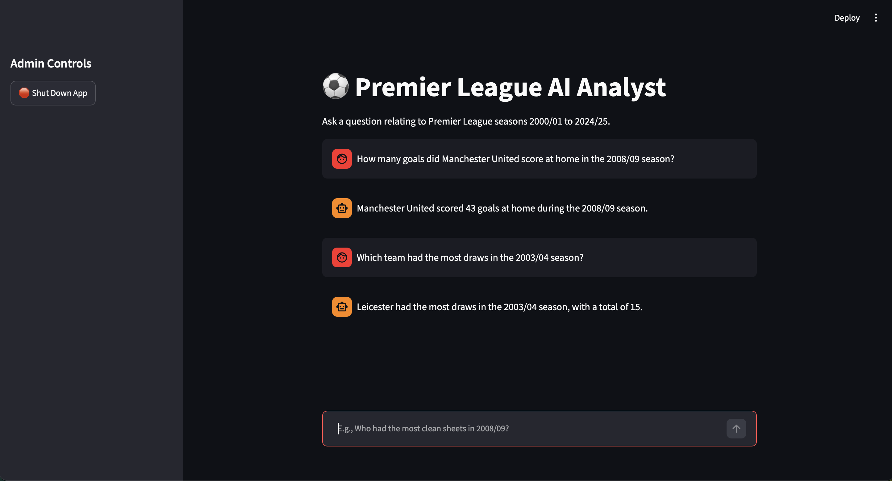
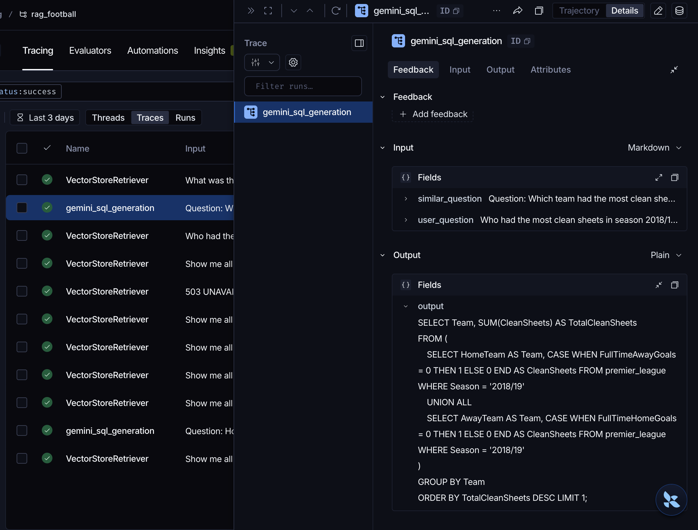

# Rag powered text-to-sql analytics system

This project implements a **Retrieval-Augmented Generation (RAG)** system that enables an LLM 
to generate precise PostgreSQL queries from 2000/01 season to the current season, refreshed from a live API.
## Overview
Instead of relying only on the LLM's own SQL ability, the system uses **dynamic few-shot prompting**:
it retrieves the 3 most similar example questions (each stored with its correct SQL) from a
vector store and injects them into the prompt, so the model has a template for the query it writes.
The examples live in a plain TXT file, and the whole pipeline is modular.


## Architecture pipeline 
The system follows a modular RAG architecture :
1. **Data Import and Cleaning** - load and inspect dataset
2. **SQL data connection** - stored in PostgreSQL and prepared for invoking queries
3. **Document ingestion** - txt file with different questions is ingested from disk
4. **Chunking and embeddings** - each chunk converted into vector embeddings
5. **Storing vectors** - stored in persistent directory with Chroma DB
6. **Searching relevant chunks** - top 3 chunks discovered with  similarity search and injected into the prompt
7. **LLM generation** - initial SQL generation guided by dynamically injected few-shot blueprints + execution against PostgreSQL in a read-only session
8. **Error feedback** - intercepting database exceptions and routing the trace through a secondary repair agent with up to 3 bounded self-correction iterations.
9. **Final response** - the LLM answers the question using only the data retrieved by the sql database
10. **User Interface** - an interactive web interface deployed using Streamlit to display conversational query results.

## Data Pipeline & Live Sync

Historical matches (2000/01 onward) are stored in PostgreSQL. New matches are
pulled from the football-data.org API by `sync.py`:

1. **Extract**: request finished Premier League matches since the newest match
   already stored (the range deliberately overlaps by one day, so a partial
   matchday can never be missed).
2. **Transform**: map API team names to the dataset's naming (`Brighton Hove` →
   `Brighton`), derive the season label and the result letter, and leave
   statistics the API doesn't provide (shots, corners, fouls, cards) as NULL.
3. **Load**: `INSERT ... ON CONFLICT DO NOTHING` against a unique constraint on
   (season, home team, away team), so the sync is idempotent and safe to re-run.

The sync runs when the app starts, at most once every 30 days. Each run is
recorded in a `sync_log` table. If the API is unreachable, the error is reported
and the app continues with the existing data.

AI-generated SQL is executed in a **read-only** session, so a faulty or malicious
query cannot modify the data.

## Known Limitations

- Seasons 2003/04, 2004/05 and 2024/25 are missing some matches, so season-wide
  totals (points, goals, wins) for them are understated.
- Matches added by the live sync have no shots, corners, fouls, cards or half-time
  values (the free API tier doesn't provide them), so questions on those statistics
  only cover earlier seasons.
- Data is refreshed at most every 30 days, and the free API tier is rate-limited.
- Names of newly promoted clubs may need a manual entry in the team-name mapping.

##  Technical Stack
- **Programming Language:** Python 3.13
- **Database:** PostgreSQL (psycopg2)
- **Data source:** football-data.org API (live sync) + historical CSV
- **Embedding Model:** all-MiniLM-L6-v2 (Sentence-Transformers)
- **Vector Store:** ChromaDB
- **LLM:** gemini-3.1-flash-lite (Google Gemini API)
- **Interface:** Streamlit
- **Observability:** LangSmith
- **Environment:** macOS, CPU-only


## Setup Instructions

### 1. Prerequisites
- Python 3.13
- PostgreSQL running locally (e.g. Postgres.app on macOS), with a database:
  `CREATE DATABASE myproject;`
- API keys: Gemini, football-data.org (free tier), optionally LangSmith

### 2. Environment
```
python -m venv .venv
source .venv/bin/activate
pip install -r requirements.txt
```

### 3. Configuration
Create a `.env` file in the project root:
```env
GEMINI_API_KEY="your_gemini_api_key"
FOOTBALL_DATA_API_KEY="your_football_data_key"
DB_HOST=localhost
DB_PORT=5432
DB_NAME=myproject
DB_USER=your_postgres_user
DB_PASSWORD=
LANGCHAIN_API_KEY="your_langsmith_api_key"
LANGCHAIN_TRACING_V2="true"
LANGCHAIN_PROJECT="rag_football"
```

### 4. Run
```
python3 setup_postgres.py     # creates the table and loads the historical data
python3 sync.py               # optional: fetch the newest matches
python3 ingestion_pipeline_sql_examples.py
streamlit run web_interface.py
```
## Observability & Tracing (LangSmith)
Full execution telemetry is instrumented using **LangSmith** via `@traceable` decorators to provide granular visibility across the pipeline:

- **Retriever Audit:** Verifying that vector similarity search against ChromaDB returns valid few-shot SQL exemplars rather than empty payloads (`k=3`).
- **Prompt Inspection:** Auditing dynamic prompt interpolation to confirm schema metadata and retrieved blueprints are correctly injected into Gemini's system instructions.
- **Latency & Error Diagnostics:** Monitoring upstream API status codes, tracking latency breakdowns per node, and tracing execution paths through the self-healing repair loop.


## Engineering Challenges & Solutions
### 1. Entity Resolution & Schema Normalization
- **The Problem:** Natural language inputs frequently use informal team names ("Spurs", "Man United", "Wolves"), whereas the relational database requires exact strings or pattern matches.
- **The Solution:** Indexed curated few-shot query templates using `LIKE` wildcards (`LIKE '%Man%Utd%'`) in ChromaDB. When a user asks an entity-specific question, semantic retrieval injects matching query patterns into the context, conditioning the LLM to output schema-aligned filters without requiring a hardcoded alias dictionary.

### 2. Bi-directional Match Aggregations (`UNION ALL`)
- **The Problem:** Relational football datasets store data row-by-row with separate `HomeTeam` and `AwayTeam` attributes. Computing aggregate metrics (e.g., total draws, points, goal difference across a season) fails if querying only one column or relying on standard `GROUP BY`.
- **The Solution:** Injected parameterized `UNION ALL` blueprints into the retrieval index. The model learns to project home and away fixtures into a unified subquery before applying aggregations and `GROUP BY` clauses.

### 3. Agentic Self-Healing Loop
- **The Problem:** Complex natural language questions occasionally yield SQL with invalid column names or syntax errors, causing unhandled runtime exceptions (`psycopg2.Error`).
- **The Solution:** Built a bounded feedback loop ($N=3$). When PostgreSQL raises an error, the system intercepts the message, reloads the schema and calls a repair agent (`repair_sql_with_ai`) to rewrite and re-execute the query, up to 3 times.

## Evaluation & Benchmark Tests

The system was evaluated against edge cases spanning entity resolution, multi-clause aggregations, out-of-distribution entities, and automated error recovery:

| Test Category | User Question | Technical Challenge | Pipeline Execution & Behavior | Status |
|---|---|---|---|---|
| **Entity Aliasing** | *"How many goals did Manchester United score at home in 2008/09?"* | Non-exact team name matching | Retrieved blueprint using `LIKE '%Man%Utd%'`; generated exact home goal aggregate. | Passed |
| **Bi-directional Aggregation** | *"Which team had the most draws in the 2003/04 season?"* | Folding `HomeTeam` & `AwayTeam` records | Deployed `UNION ALL` subquery with `CASE WHEN FullTimeResult = 'D'` grouping. | Passed |
| **Multi-Condition Filtering** | *"Matches where Man Utd played away, conceded >2, and won (2015/16–2020/21)"* | Multiple relational predicates | Applied `AwayTeam` filter, `FullTimeHomeGoals > 2`, and `FullTimeResult = 'A'`. | Passed |
| **Out-of-Distribution Handling** | *"How many matches did Bayern Munich win in 2018/19?"* | Non-existent league entity | Executed valid SQL returning zero rows; LLM grounded answer in empty result without hallucination. | Passed |
| **Autonomous Self-Repair** | Question referencing non-existent column (e.g., `points_scored`) | Handling `sqlite3.OperationalError` | Database error intercepted; repair prompt corrected syntax against schema on attempt 2/3. | Passed |


