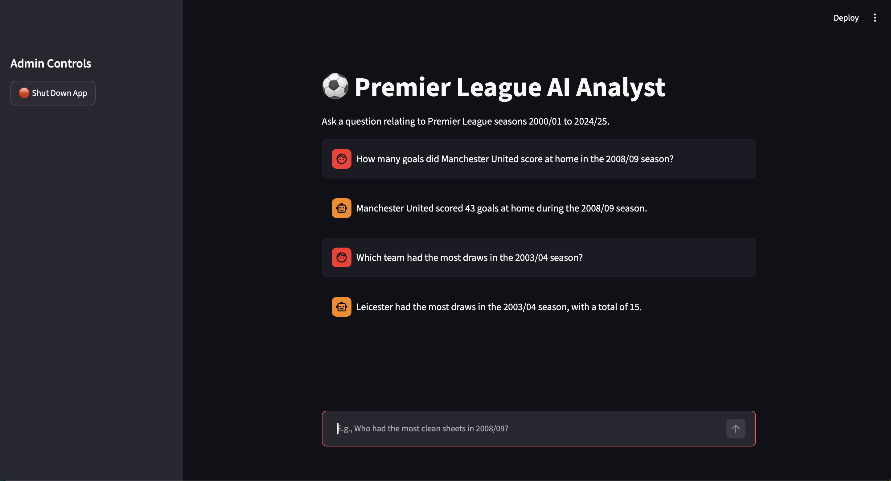
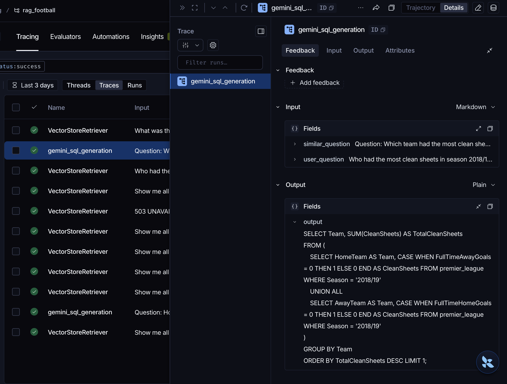

# Rag powered text-to-sql analytics system

This project implements a **Retrieval-Augmented Generation (RAG)** system that enables an LLM 
to generate precise SQLite queries across Premier League match data from seasons 2000/01 to 2024/25.
## Overview
Instead of relying only on LLM ability of 
SQL the system retrieves using **Dynamic Few-Shot prompting** top 3 similar questions asked by the user and answered 
with the query, so it has a basis of how to generate a query.
The system supports TXT documents and demonstrates a complete, modular RAG pipeline suitable for real-world AI applications.


## Architecture pipeline 
The system follow a modular RAG architecture :
1. **Data Import and Cleaning** - load and inspect dataset
2. **SQL data connection** - loaded into sqlite3 and prepared for invoking queries
3. **Document ingestion** - txt file with different questions is ingested from disk
4. **Chunking and embeddings** - each chunk converted into vector embeddings
5. **Storing vectors** - stored in persistent directory with Chroma DB
6. **Searching relevant chunks** - top 3 chunks discovered with  similarity search and injected into the prompt
7. **LLM generation** - initial SQL generation guided by dynamically injected few-shot blueprints + execution against sqlite3
8. **Error feedback** - intercepting database exceptions and routing the trace through a secondary repair agent with up to 3 bounded self-correction iterations.
9. **Final response** - the LLM answers the question using only the data retrieved by the sql database
10. **User Interface** - an interactive web interface deployed using Streamlit to display conversational query results.

##  Technical Stack

- **Programming Language:** Python 3.13
- **Embedding Model:** all-MiniLM-L6-v2 (Sentence-Transformers)
- **Vector Store:** ChromaDB 
- **LLM:** google/gemini-3.1-flash-lite
- **Environment:** MacOS, CPU-only


##  Setup Instructions

### Create and activate virtual environment (macOS / Linux)

Create a `.env` file in the root directory:
```env
GEMINI_API_KEY="your_gemini_api_key"
LANGCHAIN_API_KEY="your_langsmith_api_key"
LANGCHAIN_TRACING_V2="true"
LANGCHAIN_PROJECT="rag_football"

python -m venv .venv
source .venv/bin/activate
```


### Installing dependencies

```
pip install -r requirements.txt
```
### How to Run the System

Launch the database and start the interactive UI

```
python3 database_setup.py
python3 ingestion_pipeline_sql_examples.py
streamlit run web_interface.py
```
## Observability & Tracing (LangSmith)
Full execution telemetry is instrumented using **LangSmith** via `@traceable` decorators to provide granular visibility across the pipeline:

- **Retriever Audit:** Verifying that vector similarity search against ChromaDB returns valid few-shot SQL exemplars rather than empty payloads (`k=3`).
- **Prompt Inspection:** Auditing dynamic prompt interpolation to confirm schema metadata and retrieved blueprints are correctly injected into Gemini's system instructions.
- **Latency & Error Diagnostics:** Monitoring upstream API status codes, tracking latency breakdowns per node, and tracing execution paths through the self-healing repair loop.


## Engineering Challenges & Solutions
### 1. Entity Resolution & Schema Normalization
- **The Problem:** Natural language inputs frequently use informal team names ("Spurs", "Man United", "Wolves"), whereas the relational database requires exact strings or pattern matches.
- **The Solution:** Indexed curated few-shot query templates using `LIKE` wildcards (`LIKE '%Man%Utd%'`) in ChromaDB. When a user asks an entity-specific question, semantic retrieval injects matching query patterns into the context, conditioning the LLM to output schema-aligned filters without requiring a hardcoded alias dictionary.

### 2. Bi-directional Match Aggregations (`UNION ALL`)
- **The Problem:** Relational football datasets store data row-by-row with separate `HomeTeam` and `AwayTeam` attributes. Computing aggregate metrics (e.g., total draws, points, goal difference across a season) fails if querying only one column or relying on standard `GROUP BY`.
- **The Solution:** Injected parameterized `UNION ALL` blueprints into the retrieval index. The model learns to project home and away fixtures into a unified subquery before applying aggregations and `GROUP BY` clauses.

### 3. Agentic Self-Healing Loop
- **The Problem:** Complex natural language questions occasionally yield SQL with invalid column names or syntax errors, causing unhandled runtime exceptions (`sqlite3.OperationalError`).
- **The Solution:** Built a bounded feedback loop ($N=3$). When SQLite raises an exception, the system intercepts the error string, loads the schema, and calls a specialized repair agent (`repair_sql_with_ai`) to rewrite and re-execute the query autonomously before presenting output to the user.

## Evaluation & Benchmark Tests

The system was evaluated against edge cases spanning entity resolution, multi-clause aggregations, out-of-distribution entities, and automated error recovery:

| Test Category | User Question | Technical Challenge | Pipeline Execution & Behavior | Status |
|---|---|---|---|---|
| **Entity Aliasing** | *"How many goals did Manchester United score at home in 2008/09?"* | Non-exact team name matching | Retrieved blueprint using `LIKE '%Man%Utd%'`; generated exact home goal aggregate. | Passed |
| **Bi-directional Aggregation** | *"Which team had the most draws in the 2003/04 season?"* | Folding `HomeTeam` & `AwayTeam` records | Deployed `UNION ALL` subquery with `CASE WHEN FullTimeResult = 'D'` grouping. | Passed |
| **Multi-Condition Filtering** | *"Matches where Man Utd played away, conceded >2, and won (2015/16–2020/21)"* | Multiple relational predicates | Applied `AwayTeam` filter, `FullTimeHomeGoals > 2`, and `FullTimeResult = 'A'`. | Passed |
| **Out-of-Distribution Handling** | *"How many matches did Bayern Munich win in 2018/19?"* | Non-existent league entity | Executed valid SQL returning zero rows; LLM grounded answer in empty result without hallucination. | Passed |
| **Autonomous Self-Repair** | Question referencing non-existent column (e.g., `points_scored`) | Handling `sqlite3.OperationalError` | Database error intercepted; repair prompt corrected syntax against schema on attempt 2/3. | Passed |


